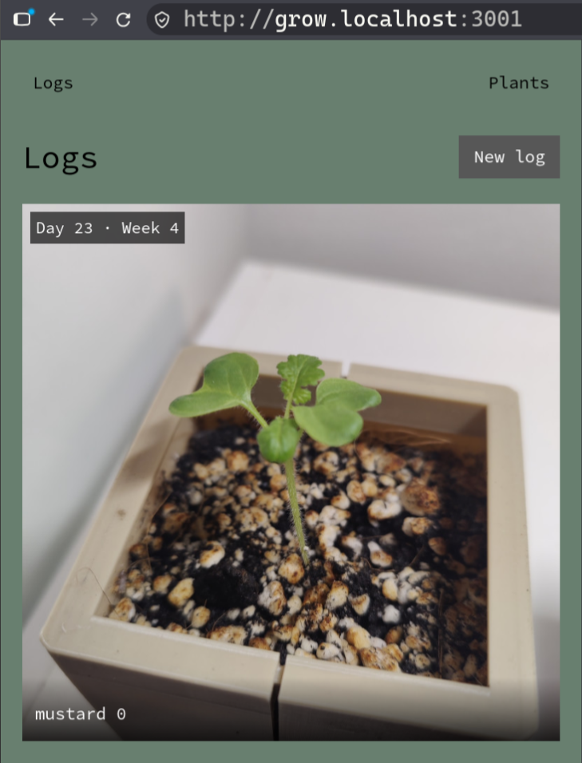

# Grow Vue [](https://github.com/ksevelyar/grow-vue/actions/workflows/ci.yml)



## Development
```
nix develop
npm ci
npm run dev
```

## Tests
```
nix develop
npm run tests
```

## Documentation
* [Plants](doc/plants.md)
* [Grow logs](doc/grow-logs.md)
* [Grow log details](doc/grow-log.md)
* [Grow log gallery and photos](doc/grow-log-gallery.md)
* [Users](doc/users.md)
